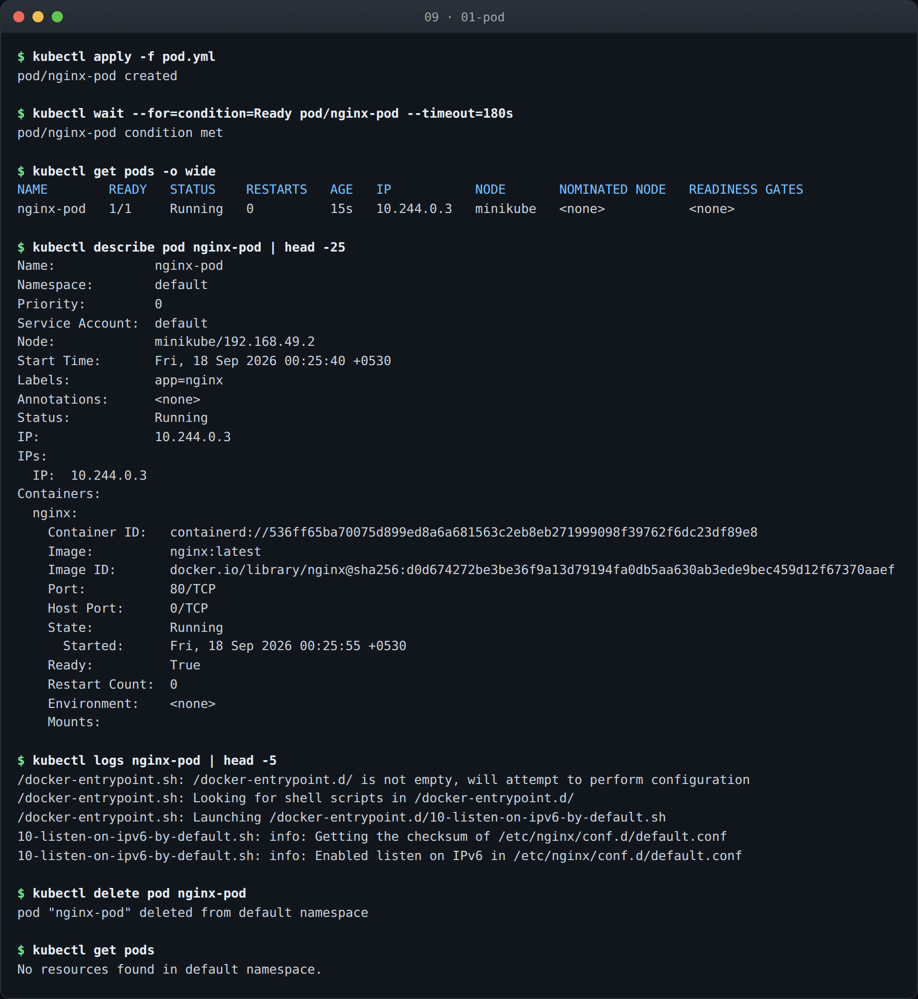
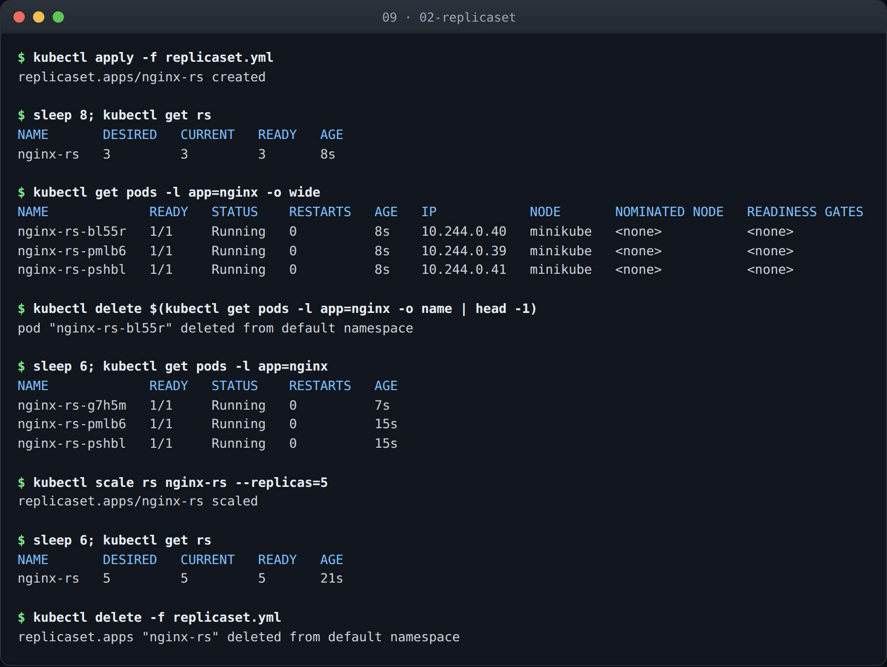
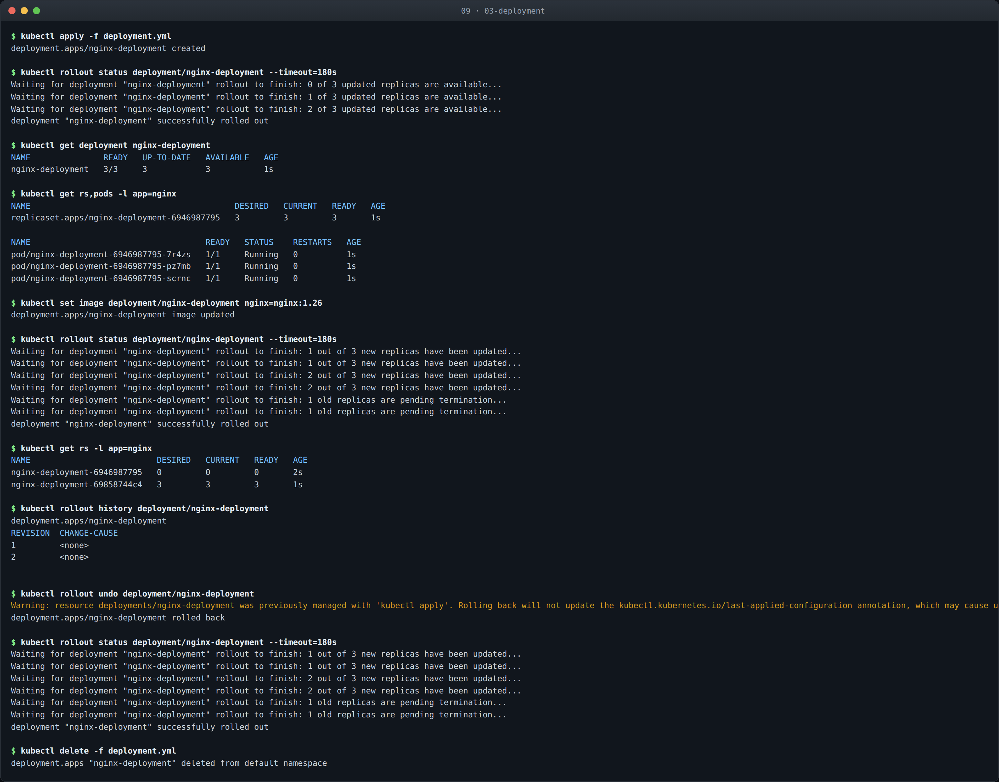

# Kubernetes Pods, ReplicaSets and Deployments

**Name:** Abdur Rahman Ibne Munir
**Enrollment number:** 24BCS10244

I built the three core workload objects in order: a bare Pod, a ReplicaSet that keeps a
set of Pods alive, and a Deployment that manages ReplicaSets and gives rolling updates and
rollbacks. Every command output below was run on my machine and pasted in.

The images in each folder are rendered from the terminal transcripts captured during
these runs. They have the same text as the blocks below, just easier to scan.

## Folder structure

```text
09-kubernetes-pods-replicasets-deployments/
├── 01-pod/            pod.yml         pod_24BCS10244.png
├── 02-replicaset/     replicaset.yml  replicaset_24BCS10244.png
├── 03-deployment/     deployment.yml  deployment_24BCS10244.png
└── README.md
```

## All three at a glance

| # | Object | Manages | Survives a pod delete | Rolling updates |
|---|---|---|---|---|
| 1 | Pod | one set of containers | no | no |
| 2 | ReplicaSet | a fixed number of identical Pods | yes | no |
| 3 | Deployment | ReplicaSets | yes | yes |

All three manifests use the label `app: nginx`, so I deleted each object before starting
the next one. If the standalone Pod were still running, the ReplicaSet would adopt it
because its selector matches, and it would create only two new pods instead of three.

## 1. Pod

```yaml
apiVersion: v1
kind: Pod

metadata:
  name: nginx-pod
  labels:
    app: nginx

spec:
  containers:
    - name: nginx
      image: nginx:latest
      ports:
        - containerPort: 80
```

```text
$ kubectl apply -f pod.yml
pod/nginx-pod created

$ kubectl get pods -o wide
NAME        READY   STATUS    RESTARTS   AGE   IP           NODE       NOMINATED NODE   READINESS GATES
nginx-pod   1/1     Running   0          15s   10.244.0.3   minikube   <none>           <none>
```

The Pod got `10.244.0.3`, an address on the cluster's pod network handed out by the CNI
plugin. It is not reachable from macOS, only from inside the cluster.

I trimmed `describe` to the fields that matter:

```text
$ kubectl describe pod nginx-pod | head -25
Name:             nginx-pod
Namespace:        default
Node:             minikube/192.168.49.2
Labels:           app=nginx
Status:           Running
IP:               10.244.0.3
Containers:
  nginx:
    Container ID:   containerd://536ff65ba70075d899ed8a6a681563c2eb8eb271999098f39762f6dc23df89e8
    Image:          nginx:latest
    Image ID:       docker.io/library/nginx@sha256:d0d674272be3be36f9a13d79194fa0db5aa630ab3ede9bec459d12f67370aaef
    Port:           80/TCP
    State:          Running
    Ready:          True
    Restart Count:  0
```

The container ID is prefixed `containerd://`, not `docker://`. minikube uses containerd as
its runtime even though the driver is Docker: Docker Desktop provides the machine, and
containerd runs the containers inside it.

```text
$ kubectl logs nginx-pod | head -5
/docker-entrypoint.sh: /docker-entrypoint.d/ is not empty, will attempt to perform configuration
/docker-entrypoint.sh: Looking for shell scripts in /docker-entrypoint.d/
/docker-entrypoint.sh: Launching /docker-entrypoint.d/10-listen-on-ipv6-by-default.sh
```

### Deleting the Pod

```text
$ kubectl delete pod nginx-pod
pod "nginx-pod" deleted from default namespace

$ kubectl get pods
No resources found in default namespace.
```

Nothing brought it back. A bare Pod has no controller watching it, so deleting it is final,
and so is a node failure or an eviction. The next two objects close this gap, which is why
a bare Pod is almost never used in production.



### What I understood

A Pod is the unit Kubernetes schedules, not a container. Everything in one Pod shares a
network namespace and an IP, which is why sidecar patterns work: two containers in a Pod
reach each other on `localhost`.

Before running this I had not realised how unprotected a bare Pod is. `RESTARTS` counts a
container crashing and being restarted in place. It does nothing if the Pod object itself
disappears, and an eviction under memory pressure does that too.

## 2. ReplicaSet

```yaml
apiVersion: apps/v1
kind: ReplicaSet

metadata:
  name: nginx-rs

spec:
  replicas: 3

  selector:
    matchLabels:
      app: nginx

  template:
    metadata:
      labels:
        app: nginx

    spec:
      containers:
        - name: nginx
          image: nginx:latest
          ports:
            - containerPort: 80
```

`spec.selector.matchLabels` and `spec.template.metadata.labels` have to agree. The selector
is what the ReplicaSet counts, and the template labels are what it stamps on the pods it
makes. If they disagree, it creates pods it cannot see, counts zero and keeps creating more.

```text
$ kubectl get rs
NAME       DESIRED   CURRENT   READY   AGE
nginx-rs   3         3         3       8s

$ kubectl get pods -l app=nginx -o wide
NAME             READY   STATUS    RESTARTS   AGE   IP            NODE       NOMINATED NODE   READINESS GATES
nginx-rs-bl55r   1/1     Running   0          8s    10.244.0.40   minikube   <none>           <none>
nginx-rs-pmlb6   1/1     Running   0          8s    10.244.0.39   minikube   <none>           <none>
nginx-rs-pshbl   1/1     Running   0          8s    10.244.0.41   minikube   <none>           <none>
```

### Self-healing

```text
$ kubectl delete $(kubectl get pods -l app=nginx -o name | head -1)
pod "nginx-rs-bl55r" deleted from default namespace

$ kubectl get pods -l app=nginx
NAME             READY   STATUS    RESTARTS   AGE
nginx-rs-g7h5m   1/1     Running   0          7s
nginx-rs-pmlb6   1/1     Running   0          15s
nginx-rs-pshbl   1/1     Running   0          15s
```

There are still three pods, and the ages show what happened. `bl55r` is gone and `g7h5m`
is 7 seconds old while the two survivors are 15. The controller noticed the count had
dropped below `replicas: 3` and created a replacement within seconds.

The replacement is a new pod with a new name and a new IP, not the old one restarted, and
`RESTARTS` stays `0`. This is why Services exist: a pod IP cannot be hardcoded when the
platform is free to replace pods.

### Scaling

```text
$ kubectl scale rs nginx-rs --replicas=5
replicaset.apps/nginx-rs scaled

$ kubectl get rs
NAME       DESIRED   CURRENT   READY   AGE
nginx-rs   5         5         5       21s
```



### What I understood

The ReplicaSet controller does not repair the pod I deleted. It creates a different one,
with a new name and new IP, and `RESTARTS` is still `0`. It reconciles a count, not an
identity. So no client can hold a pod IP, and something stable has to sit in front of the
pods. That something is a Service.

A mismatched selector fails quietly, as described above. A related thing is that this
manifest and `pod.yml` share `app: nginx`, so leaving the bare Pod running would have let
the ReplicaSet adopt it and create only two pods of its own.

## 3. Deployment

```yaml
apiVersion: apps/v1
kind: Deployment

metadata:
  name: nginx-deployment

spec:
  replicas: 3

  selector:
    matchLabels:
      app: nginx

  template:
    metadata:
      labels:
        app: nginx

    spec:
      containers:
        - name: nginx
          image: nginx:1.25
          ports:
            - containerPort: 80
```

```text
$ kubectl get deployment nginx-deployment
NAME               READY   UP-TO-DATE   AVAILABLE   AGE
nginx-deployment   3/3     3            3           1s

$ kubectl get rs,pods -l app=nginx
NAME                                          DESIRED   CURRENT   READY   AGE
replicaset.apps/nginx-deployment-6946987795   3         3         3       1s

NAME                                    READY   STATUS    RESTARTS   AGE
pod/nginx-deployment-6946987795-7r4zs   1/1     Running   0          1s
pod/nginx-deployment-6946987795-pz7mb   1/1     Running   0          1s
pod/nginx-deployment-6946987795-scrnc   1/1     Running   0          1s
```

I did not create a ReplicaSet. The Deployment did, and named it `nginx-deployment-6946987795`.
The suffix is a hash of the pod template, which matters in a moment.

`kubectl get deploy -l app=nginx` returns nothing. The label is on the pod template, not on
the Deployment object, so the Deployment has to be fetched by name.

### Rolling update

```text
$ kubectl set image deployment/nginx-deployment nginx=nginx:1.26
deployment.apps/nginx-deployment image updated

$ kubectl rollout status deployment/nginx-deployment
Waiting for deployment "nginx-deployment" rollout to finish: 1 out of 3 new replicas have been updated...
Waiting for deployment "nginx-deployment" rollout to finish: 2 out of 3 new replicas have been updated...
Waiting for deployment "nginx-deployment" rollout to finish: 1 old replicas are pending termination...
deployment "nginx-deployment" successfully rolled out
```

This output is trimmed. The real transcript repeats each line several times as it polls.

New pods come up before the old ones go away, a few at a time, so the app never drops to
zero capacity. That is the default `RollingUpdate` strategy.

```text
$ kubectl get rs -l app=nginx
NAME                          DESIRED   CURRENT   READY   AGE
nginx-deployment-6946987795   0         0         0       2s
nginx-deployment-69858744c4   3         3         3       1s
```

There are two ReplicaSets now. The old one is scaled to 0 but not deleted, which is what
makes a rollback instant: Kubernetes scales the old ReplicaSet back up instead of
rebuilding the previous version.

```text
$ kubectl rollout history deployment/nginx-deployment
deployment.apps/nginx-deployment
REVISION  CHANGE-CAUSE
1         <none>
2         <none>
```

`CHANGE-CAUSE` is `<none>` because I used `kubectl set image` without recording an
annotation. Setting `kubernetes.io/change-cause` would make the history say why each
revision exists.

### Rollback

```text
$ kubectl rollout undo deployment/nginx-deployment
Warning: resource deployments/nginx-deployment was previously managed with 'kubectl apply'. Rolling back will not update the kubectl.kubernetes.io/last-applied-configuration annotation, which may cause unexpected behavior on future 'kubectl apply' operations.
deployment.apps/nginx-deployment rolled back

$ kubectl rollout status deployment/nginx-deployment
deployment "nginx-deployment" successfully rolled out
```

I left the warning in on purpose. `rollout undo` changes the live object but not the
`last-applied-configuration` annotation that `kubectl apply` diffs against. So the cluster
is back on 1.25, but my `deployment.yml` on disk and the annotation still describe the
applied state, and the next `kubectl apply` could quietly undo the rollback. The cleaner
fix is to revert the manifest in git and re-apply, and keep `rollout undo` for emergencies.



### What I understood

A Deployment does not manage pods directly. It manages ReplicaSets, and they manage pods,
so there are three layers and each adds one capability. The hash suffix on
`nginx-deployment-6946987795` is computed from the pod template, so changing the image
produces a different ReplicaSet instead of changing the existing one.

That is why rollback is instant: the old ReplicaSet is scaled to zero and kept, so
`rollout undo` scales it back up instead of rebuilding anything. It also explains why
`kubectl get rs` shows two entries after an update, and why old ones accumulate until
`revisionHistoryLimit` trims them.

Because `rollout undo` only touches the live object, my manifest on disk never learns about
it. It is good for getting the old version back in seconds, while the lasting fix is
reverting the manifest in git.

## Notes

Each layer adds one capability. A Pod runs containers, a ReplicaSet keeps N of them alive,
and a Deployment manages successive ReplicaSets so the template can change without
downtime. The lower layers can be used directly, but in practice Deployments are written
and they create the rest.

A ReplicaSet does not update pods. Changing the image in `replicaset.yml` and re-applying
leaves the running pods untouched, because the ReplicaSet only cares about the count, not
whether existing pods match the current template. The Deployment fills that gap.

To reproduce this section:

```bash
cd 01-pod        && kubectl apply -f pod.yml        && cd ..
cd 02-replicaset && kubectl apply -f replicaset.yml && cd ..
cd 03-deployment && kubectl apply -f deployment.yml && cd ..
```
