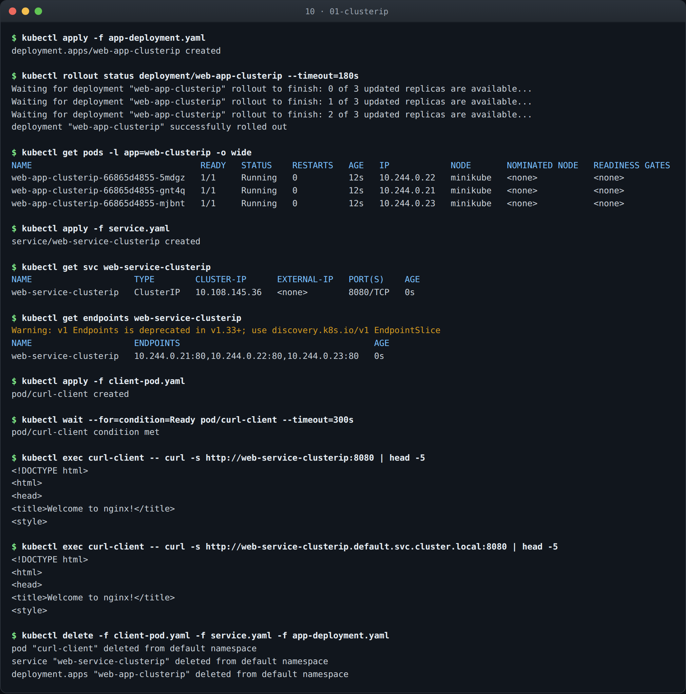
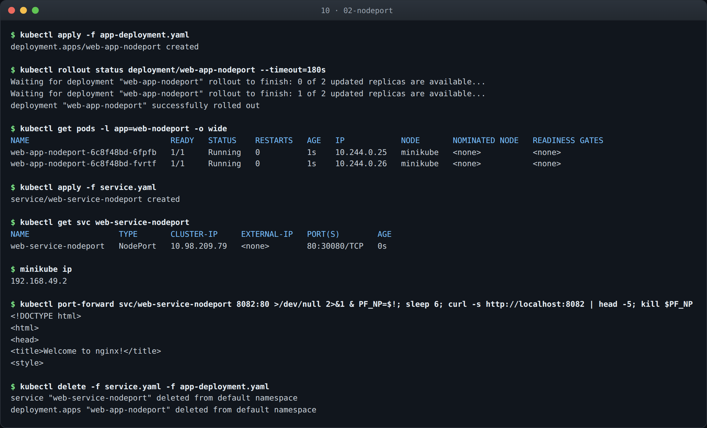
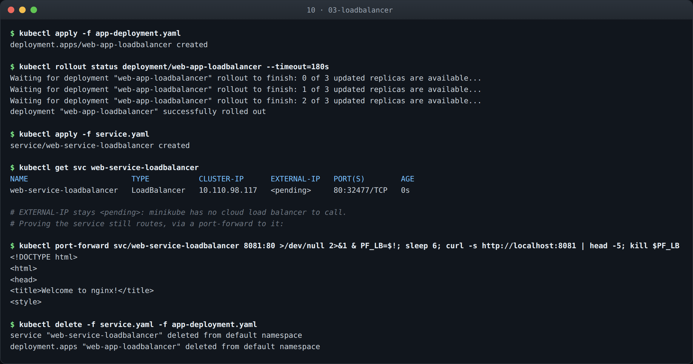
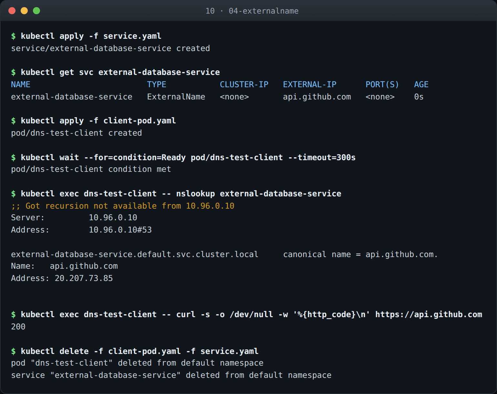
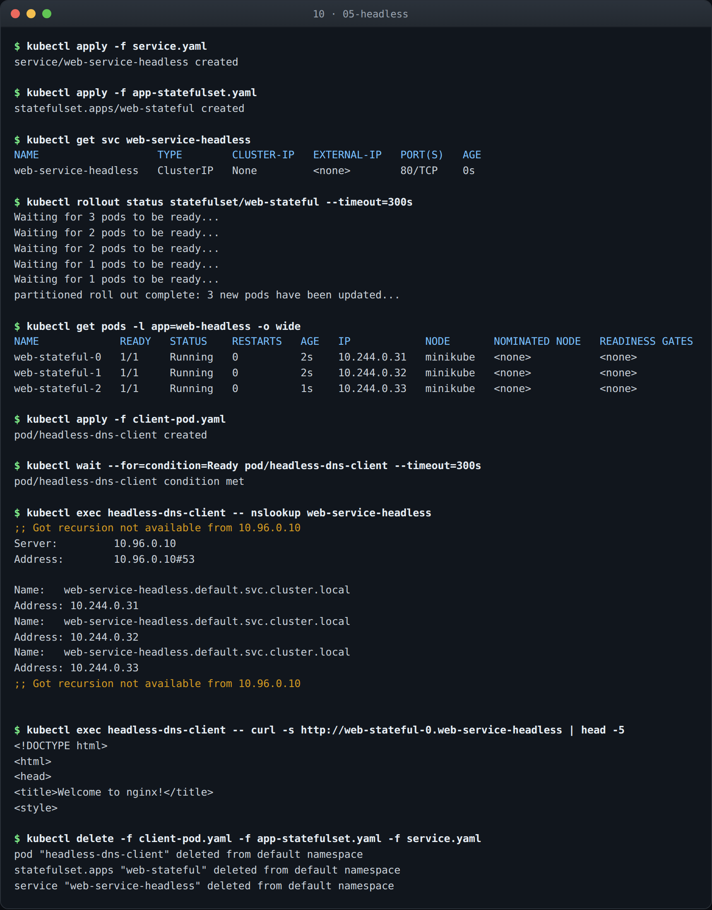

# Kubernetes Networking & Services

**Name:** Abdur Rahman Ibne Munir
**Enrollment number:** 24BCS10244

I set up the five Service types, each backed by the same kind of nginx workload so the only
thing that changes between them is how traffic reaches the pods. Every command output below
was run on my machine and pasted in.

The images in each folder are rendered from the terminal transcripts captured during
these runs. They have the same text as the blocks below, just easier to scan.

## Folder structure

```text
10-kubernetes-networking-services/
├── 01-clusterip/      app-deployment.yaml  service.yaml  client-pod.yaml
├── 02-nodeport/       app-deployment.yaml  service.yaml
├── 03-loadbalancer/   app-deployment.yaml  service.yaml
├── 04-externalname/   service.yaml         client-pod.yaml
├── 05-headless/       app-statefulset.yaml service.yaml  client-pod.yaml
└── README.md

Each subsection folder also holds its `*_24BCS10244.png` terminal capture.
```

## All five at a glance

| # | Type | Reachable from | Virtual IP | DNS returns | Typical use |
|---|---|---|---|---|---|
| 1 | ClusterIP | inside the cluster | `10.108.145.36` | the Service IP | service-to-service calls |
| 2 | NodePort | any node IP, port 30080 | `10.98.209.79` | the Service IP | local or bare-metal access |
| 3 | LoadBalancer | the internet, via a cloud LB | `10.110.98.117` | the Service IP | public traffic |
| 4 | ExternalName | inside the cluster | none | a CNAME | aliasing an external host |
| 5 | Headless | inside the cluster, per-pod | `None` | every pod IP | StatefulSets |

## Running these on macOS

The cluster runs on minikube with the `docker` driver, so the node is a container on an
internal Docker network at `192.168.49.2`. macOS has no route to that address, which is why
the reachability tests below use `kubectl port-forward` instead of curling the node IP
directly. The Services behave the same as they would on a real cluster. Only the path from
my laptop to the node is different, and I say so in each section where it matters.

## 1. ClusterIP

This is the default type. Kubernetes allocates a stable virtual IP that only exists inside
the cluster, and load-balances across whichever pods currently match the selector.

```yaml
spec:
  type: ClusterIP
  selector:
    app: web-clusterip
  ports:
    - name: http
      port: 8080        # the port the Service exposes
      targetPort: 80    # the port nginx listens on
```

```text
$ kubectl get pods -l app=web-clusterip -o wide
NAME                                 READY   STATUS    RESTARTS   AGE   IP            NODE
web-app-clusterip-66865d4855-5mdgz   1/1     Running   0          12s   10.244.0.22   minikube
web-app-clusterip-66865d4855-gnt4q   1/1     Running   0          12s   10.244.0.21   minikube
web-app-clusterip-66865d4855-mjbnt   1/1     Running   0          12s   10.244.0.23   minikube

$ kubectl get svc web-service-clusterip
NAME                    TYPE        CLUSTER-IP      EXTERNAL-IP   PORT(S)    AGE
web-service-clusterip   ClusterIP   10.108.145.36   <none>        8080/TCP   0s

$ kubectl get endpoints web-service-clusterip
NAME                    ENDPOINTS                                      AGE
web-service-clusterip   10.244.0.21:80,10.244.0.22:80,10.244.0.23:80   0s
```

The endpoints line matters most here. The Service found all three pod IPs and bound to them
on port 80, which is the `targetPort` and not the `port`. If this list comes back empty, the
selector does not match the pod labels, which is the most common reason a Service appears to
do nothing.

`kubectl` also warned that `v1 Endpoints` is deprecated in favour of
`discovery.k8s.io/v1 EndpointSlice`. The newer API scales better on large clusters, where
one Endpoints object listing thousands of IPs became a bottleneck.

I tested from inside the cluster using a `nicolaka/netshoot` pod:

```text
$ kubectl exec curl-client -- curl -s http://web-service-clusterip:8080 | head -5
<!DOCTYPE html>
<html>
<head>
<title>Welcome to nginx!</title>

$ kubectl exec curl-client -- curl -s http://web-service-clusterip.default.svc.cluster.local:8080 | head -5
<!DOCTYPE html>
<html>
<head>
<title>Welcome to nginx!</title>
```

Both forms work. The short name resolves because pods get a search domain of
`default.svc.cluster.local`. The long form is the fully qualified name, and it is the one to
use when calling across namespaces.



### What I understood

The endpoints list is the Service. The virtual IP and the DNS name are stable packaging
around that list, and the list is rebuilt continuously from whatever pods currently match
the selector. When a Service does not work, `kubectl get endpoints` shows in one line
whether it is a routing problem or a labelling problem, and it is almost always labelling.

The `port` / `targetPort` split confused me until I saw the endpoints bound to `:80` and not
`:8080`. `port` is what callers dial on the Service, and `targetPort` is what the container
listens on. They are separate so the Service can present a tidy port without the
application changing.

## 2. NodePort

A NodePort opens the same port on every node in the cluster and forwards it to the Service.

```yaml
spec:
  type: NodePort
  ports:
    - port: 80
      targetPort: 80
      nodePort: 30080
```

```text
$ kubectl get svc web-service-nodeport
NAME                   TYPE       CLUSTER-IP     EXTERNAL-IP   PORT(S)        AGE
web-service-nodeport   NodePort   10.98.209.79   <none>        80:30080/TCP   0s

$ minikube ip
192.168.49.2
```

`80:30080/TCP` means port 80 inside the cluster and 30080 on the node. A NodePort is a
ClusterIP plus a node-level port. It keeps the virtual IP and adds another way in.

`30080` sits inside the default 30000-32767 range. Kubernetes reserves that band so a
NodePort cannot collide with a normal port like 80 or 443 already bound on the host.

The node's address is `192.168.49.2`, which is inside Docker's network and not routable
from macOS, so I checked reachability through a forwarded port:

```text
$ kubectl port-forward svc/web-service-nodeport 8082:80 & sleep 6; curl -s http://localhost:8082 | head -5
<!DOCTYPE html>
<html>
<head>
<title>Welcome to nginx!</title>
```

On a bare-metal or cloud cluster, `curl http://<node-ip>:30080` would have worked directly.
`minikube service web-service-nodeport --url` is another way to get a usable address, and it
opens the same kind of tunnel.



### What I understood

A NodePort adds to the ClusterIP and does not replace it: the output still shows
`10.98.209.79` alongside `80:30080/TCP`. That was the first sign that these types are
layered on each other.

The 30000-32767 range is reserved so a NodePort can never collide with a normal service port
already bound on the host. The cost is ugly URLs. The bigger problem is that the port is
opened on every node, so in front of a real cluster something still has to spread traffic
across them. LoadBalancer fills that gap.

## 3. LoadBalancer

A LoadBalancer Service asks the underlying infrastructure for an external load balancer and
points it at the Service.

```text
$ kubectl get svc web-service-loadbalancer
NAME                       TYPE           CLUSTER-IP      EXTERNAL-IP   PORT(S)        AGE
web-service-loadbalancer   LoadBalancer   10.110.98.117   <pending>     80:32477/TCP   0s
```

`EXTERNAL-IP` is `<pending>`, and it stays that way. A LoadBalancer Service is a request to
a cloud provider's controller: on EKS it provisions an ELB, on GKE a Google load balancer.
minikube has nothing to ask, so the request is never fulfilled. That is not an error, just
the normal state of a cloud-dependent object on a local cluster.

It still allocated `32477` as a node port. A LoadBalancer is layered on top of NodePort,
which is layered on ClusterIP, so each type builds on the one before it.

The Service still routes correctly, which the port-forward shows:

```text
$ kubectl port-forward svc/web-service-loadbalancer 8081:80 & sleep 6; curl -s http://localhost:8081 | head -5
<!DOCTYPE html>
<html>
<head>
<title>Welcome to nginx!</title>
```

`minikube tunnel` is the other option. It runs a process that assigns the pending external
IP and routes to it, but it needs root because it binds privileged ports.



### What I understood

`<pending>` is an unanswered request, not a failure. A LoadBalancer Service asks the
infrastructure for an external address. On EKS a controller provisions an ELB and writes the
address back, and on minikube nothing is listening. Seeing it stay pending made the type
easier to understand than it would have been on a cloud cluster, where it just works and the
mechanism stays hidden.

The node port it still allocated (`32477`) confirms the layering: LoadBalancer is NodePort
plus an external address, and NodePort is ClusterIP plus a node-level port.

## 4. ExternalName

ExternalName is the odd one out: no selector, no pods, no virtual IP. It is a DNS alias that
lets in-cluster code use a stable internal name for something that lives outside.

```yaml
spec:
  type: ExternalName
  externalName: api.github.com
```

```text
$ kubectl get svc external-database-service
NAME                        TYPE           CLUSTER-IP   EXTERNAL-IP      PORT(S)   AGE
external-database-service   ExternalName   <none>       api.github.com   <none>    0s
```

`CLUSTER-IP` and `PORT(S)` are both `<none>` because there is nothing to load-balance and
no port to map. This Service never handles traffic.

```text
$ kubectl exec dns-test-client -- nslookup external-database-service
Server:		10.96.0.10
Address:	10.96.0.10#53

external-database-service.default.svc.cluster.local	canonical name = api.github.com.
Name:	api.github.com
Address: 20.207.73.85

$ kubectl exec dns-test-client -- curl -s -o /dev/null -w '%{http_code}\n' https://api.github.com
200
```

CoreDNS returned a CNAME and not an A record. The request is handed off to normal DNS from
there, which resolved `api.github.com` to `20.207.73.85`. The traffic never passes through
kube-proxy.

In practice, `database-service` could point at an RDS hostname in production and at a
container in staging, and the application code would stay the same. TLS and `Host` headers
still see the real name, though, so an ExternalName in front of an HTTPS endpoint needs the
certificate to match the target and not the alias.



### What I understood

This is the one type that never touches kube-proxy. There is no virtual IP and no endpoints
list, so no traffic passes through the Service. CoreDNS answers with a CNAME and the pod
resolves the real name itself, which is what `CLUSTER-IP: <none>` and `PORT(S): <none>` in
the output show.

The catch I would not have predicted is that TLS and `Host` headers still see the real
hostname. The alias is only a DNS indirection, so a certificate has to match the target and
not the name the app uses.

## 5. Headless

Setting `clusterIP: None` makes Kubernetes skip the virtual IP entirely. DNS then returns
the pod addresses themselves.

```yaml
spec:
  clusterIP: None
  selector:
    app: web-headless
```

I backed it with a StatefulSet instead of a Deployment, so the pods get stable ordinal names:

```text
$ kubectl get svc web-service-headless
NAME                   TYPE        CLUSTER-IP   EXTERNAL-IP   PORT(S)   AGE
web-service-headless   ClusterIP   None         <none>        80/TCP    0s

$ kubectl rollout status statefulset/web-stateful
Waiting for 3 pods to be ready...
Waiting for 2 pods to be ready...
Waiting for 1 pods to be ready...
partitioned roll out complete: 3 new pods have been updated...

$ kubectl get pods -l app=web-headless -o wide
NAME             READY   STATUS    RESTARTS   AGE   IP            NODE
web-stateful-0   1/1     Running   0          2s    10.244.0.31   minikube
web-stateful-1   1/1     Running   0          2s    10.244.0.32   minikube
web-stateful-2   1/1     Running   0          1s    10.244.0.33   minikube
```

The pods are `web-stateful-0`, `-1` and `-2`: predictable names, created in order, unlike
the random suffixes a Deployment hands out. The rollout output counts down one pod at a time
because a StatefulSet starts them sequentially.

```text
$ kubectl exec headless-dns-client -- nslookup web-service-headless
Server:		10.96.0.10
Address:	10.96.0.10#53

Name:	web-service-headless.default.svc.cluster.local
Address: 10.244.0.31
Name:	web-service-headless.default.svc.cluster.local
Address: 10.244.0.32
Name:	web-service-headless.default.svc.cluster.local
Address: 10.244.0.33
```

There are three A records, one per pod. The same lookup on the ClusterIP Service returned a
single virtual IP. Here the client sees the individual backends and decides for itself which
to talk to.

Each pod is also individually addressable:

```text
$ kubectl exec headless-dns-client -- curl -s http://web-stateful-0.web-service-headless | head -5
<!DOCTYPE html>
<html>
<head>
<title>Welcome to nginx!</title>
```

`<pod-name>.<service-name>` resolves to one specific pod. That makes headless Services a
good fit for databases and message brokers: a Postgres replica needs to reach the primary,
not whichever node a load balancer picked.



### What I understood

`clusterIP: None` reverses the usual model. Instead of hiding three pods behind one address,
DNS hands back all three and the client chooses. That does nothing useful for stateless web
servers, but it matters for anything stateful, because a Postgres replica needs the primary
and not whichever backend a load balancer happened to pick.

The StatefulSet is what makes that addressable. `web-stateful-0/-1/-2` are stable, ordered
names created one at a time (the rollout output counts down), where a Deployment would have
produced three random suffixes in parallel. Stable names plus per-pod DNS give
`web-stateful-0.web-service-headless`, an address that survives the pod being rescheduled.

## Notes

The types are layered. ClusterIP is the base, NodePort is ClusterIP plus a port on every
node, and LoadBalancer is NodePort plus a cloud load balancer pointed at it. The
LoadBalancer Service in the output above still shows a ClusterIP and a node port.
ExternalName and Headless sit outside that stack, and neither allocates a virtual IP.

Every Service except ExternalName finds its pods with a selector. When a Service returns
nothing, `kubectl get endpoints <name>` is the first command to run: empty endpoints means
the selector and the pod labels disagree.

To reproduce this section, each folder is self-contained:

```bash
cd 01-clusterip
kubectl apply -f app-deployment.yaml -f service.yaml -f client-pod.yaml
# ...
kubectl delete -f client-pod.yaml -f service.yaml -f app-deployment.yaml
```
